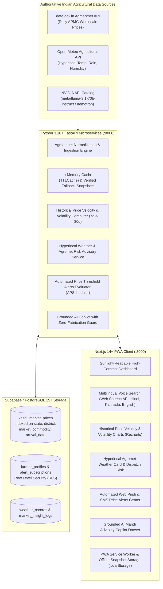

# 🌾 KrishiMandi Intelligence (कृषि मंडी / ಕೃಷಿ ಮಂಡಿ)

**KrishiMandi Intelligence (`krishi-mandi-platform`)** is an authoritative, real-time agricultural commodity price intelligence platform, historical market analytics engine, and AI-driven farmer advisory copilot designed to eliminate distress selling for Indian farmers, Farmer Producer Organizations (FPOs), APMC traders, and commission agents.

---

## 🏛️ System Architecture



---

## 🚀 Core Capabilities

1. **Canonical APMC Mandi Daily Prices**:
   - Ingests verified wholesale market arrivals and prices (Min, Max, Modal in ₹/Quintal) from official government sources (`data.gov.in` Agmarknet).
   - Resilient multi-tier architecture with in-memory caching and persistent verified fallback snapshots for 100% uptime.

2. **7-Day & 30-Day Historical Velocity & Volatility Analytics**:
   - Computes price velocity (% price change across time windows) and volatility indicators.
   - Categorizes market movement into clear visual badges: **Rising (तेजी)**, **Falling (मंदी)**, and **Steady (स्थिर)**.
   - Interactive Recharts area chart with modal price curve and min-max spread envelope.

3. **Multilingual Regional Voice Search**:
   - Hands-free voice querying in **Hindi (`hi-IN`)**, **Kannada (`kn-IN`)**, and **English (`en-IN`)** via the browser's Web Speech API.
   - Visual pulsing soundwave animation during speech capture.
   - Defensively sanitizes input and performs word-boundary matching across localized crop aliases.

4. **Hyperlocal Weather & Agromet Dispatch Risk**:
   - Real-time weather telemetry (Temperature, Relative Humidity, Rainfall, Wind Speed) via Open-Meteo.
   - Agrometeorological operational advice for morning foliar spraying, crop harvesting, and APMC yard transport planning.

5. **Free Automated Multi-Channel Price Alerts**:
   - Farmers set custom selling thresholds (e.g. "Notify me when Tomato in Mysore rises above ₹1,900/q").
   - Multi-channel delivery options: Web Push Notifications, SMS, and In-App notifications.
   - Background APScheduler job evaluates alerts against fresh market arrivals with deduplicated delivery logging.

6. **Grounded AI Mandi Advisory Copilot (NVIDIA NIM)**:
   - Powered by **NVIDIA NIM Foundation Models** (`https://integrate.api.nvidia.com/v1`).
   - Zero-Fabrication Guarantee: Grounded strictly on verified Agmarknet price arrivals with explicit citations.
   - Trilingual response generation in English, Hindi, and Kannada.

7. **Sunlight-Readable Progressive Web App (PWA)**:
   - High visual density, bold typography, and one-thumb touch targets (min 44px) engineered for outdoor sunlight conditions in APMC yards.
   - "Sunlight Boost" high-contrast mode toggle.
   - Offline snapshot caching via Service Worker (`sw.js`) and `localStorage` so farmers retain access during 2G/3G connectivity drops.

---

## 🛠️ Technology Stack

| Layer | Technology |
|---|---|
| **Frontend Framework** | Next.js 14+ (App Router), React 18, TypeScript (Strict Mode) |
| **Frontend Styling & UI** | Tailwind CSS, Lucide Icons, Recharts |
| **Frontend Capabilities** | Progressive Web App (PWA), Web Speech API, Web Audio API |
| **Backend Framework** | FastAPI (Python 3.10+), Pydantic v2, Uvicorn |
| **Task Scheduling** | APScheduler (Automated alert evaluation & mandi sync) |
| **AI LLM Orchestrator** | NVIDIA NIM Foundation Models (`https://integrate.api.nvidia.com/v1`) |
| **Database** | Supabase / PostgreSQL 15+ (with SQLite local fallback) |
| **Containerization** | Docker, Docker Compose |

---

## 📦 Directory Structure

```
krishi-mandi-platform/
├── app/                        # Python FastAPI Backend
│   ├── api/
│   │   ├── krishi_routes.py    # APMC Mandi, Weather, Alerts & AI Endpoints
│   │   └── routes.py           # Core System Routes
│   ├── database/
│   │   ├── database.py         # SQLAlchemy Engine & Session Configuration
│   │   ├── krishi_models.py    # Market Prices, Farmer Profiles, Alerts, Weather Models
│   │   └── krishi_repository.py# Database CRUD & Analytical Aggregations
│   ├── intelligence/
│   │   └── krishi_ai.py        # NVIDIA NIM Grounded Copilot & NLP Normalizer
│   ├── services/
│   │   ├── agmarknet.py        # data.gov.in Agmarknet API & Snapshot Fallback
│   │   ├── alerts.py           # Multi-Channel Price Threshold Alert Service
│   │   └── weather.py          # Open-Meteo Agricultural Weather & Agromet Advisory
│   ├── config.py               # Pydantic Settings & Environment Variables
│   └── main.py                 # FastAPI Application Lifespan & APScheduler
├── frontend/                   # Next.js 14+ TypeScript PWA Frontend
│   ├── public/
│   │   ├── manifest.json       # Web App Manifest
│   │   ├── sw.js               # Service Worker for Offline Caching
│   │   ├── icon-192.png        # PWA Icon 192x192
│   │   └── icon-512.png        # PWA Icon 512x512
│   ├── src/
│   │   ├── app/
│   │   │   ├── layout.tsx      # Root Layout with PWA & Viewport Metadata
│   │   │   ├── page.tsx        # Main KrishiMandi Operational Cockpit
│   │   │   └── globals.css     # Tailwind CSS Configuration
│   │   ├── components/
│   │   │   ├── Header.tsx      # Sunlight & Language Toggle Navigation
│   │   │   ├── MandiPriceBoard.tsx # Sunlight-Readable APMC Price Grid
│   │   │   ├── VoiceSearch.tsx # Web Speech API Multilingual Voice Search
│   │   │   ├── WeatherAdvisoryCard.tsx # Open-Meteo Agromet Risk Indicators
│   │   │   ├── PriceAnalyticsModal.tsx # Recharts 7d & 30d Velocity / Volatility
│   │   │   ├── PriceAlertsModal.tsx # Multi-Channel Price Threshold Alert Center
│   │   │   └── AICopilotDrawer.tsx # Grounded NVIDIA NIM Mandi Copilot
│   │   ├── lib/
│   │   │   ├── translations.ts # Full Trilingual Dictionary (EN, HI, KN)
│   │   │   └── offlineStorage.ts # Offline Snapshot Caching & Storage Helper
│   │   └── types/
│   │       └── krishi.ts       # Strict TypeScript Type Definitions
│   ├── package.json
│   ├── tailwind.config.ts
│   └── tsconfig.json
├── supabase/
│   └── migrations/
│       └── 20261017000000_krishimandi_schema.sql # PostgreSQL 15+ Migration Script
├── tests/
│   └── test_krishibhav.py      # End-to-End Backend Verification Test Suite
├── .env.example                # Sample Environment Variables
├── docker-compose.yml          # Container Orchestration
├── Dockerfile                  # Backend Dockerfile
└── requirements.txt            # Python Dependencies
```

---

## ⚡ Quick Start Guide

### 1. Backend Setup

```bash
# Activate virtual environment
.\venv\Scripts\activate

# Install Python requirements
pip install -r requirements.txt

# Run database initialization and startup
python -m uvicorn app.main:app --host 0.0.0.0 --port 8000 --reload
```
The FastAPI backend will be accessible at `http://localhost:8000` (Swagger docs at `http://localhost:8000/docs`).

### 2. Frontend Setup

```bash
cd frontend

# Install Node dependencies
npm install

# Run Next.js development server
npm run dev
```
The Next.js PWA will be accessible at `http://localhost:3000`.

### 3. Running Production Build

```bash
cd frontend
npm run build
npm start
```

### 4. Running Backend Verification Tests

```bash
pytest tests/test_krishibhav.py -v
```

---

## 🛡️ Zero-Fabrication Guarantee & Grounding Guard

To protect farmers from financial distress, KrishiMandi enforces strict grounding rules:
1. **Authoritative Record Matching**: AI queries are mapped to verified APMC arrival records using multilingual NLP entity normalization.
2. **Deterministic Fallback**: If upstream NIM endpoints encounter network latency, the platform generates a grounded, factual response using authentic local database records.
3. **Refusal on Unverified Commodities**: If a farmer inquires about an unverified or nonexistent commodity in a given mandi, the assistant explicitly refuses to fabricate prices.

---

## 📜 License
KrishiMandi Intelligence is open-source under the MIT License as a public good for agricultural transparency.
